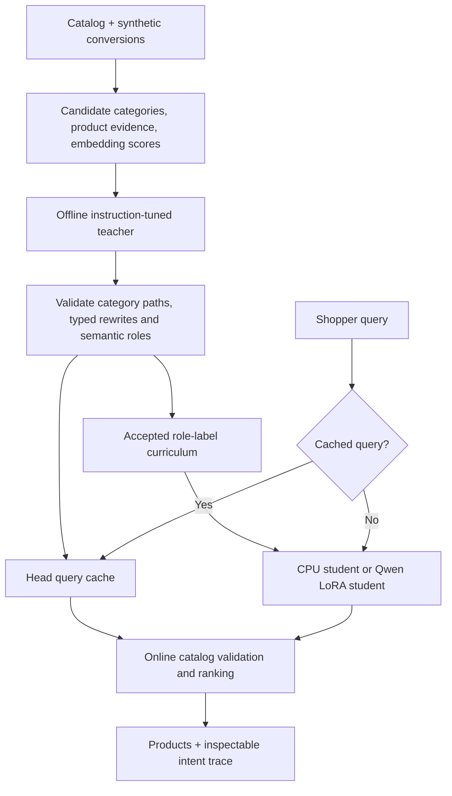

# Pulp Fictional

A fictional grocery market with a working intent engine. Type **bread no gluten**, open **Intent trace**, and follow the query from the teacher cache to the two matching loaves. Try **vegan roast** to see a higher-converting beef category get rejected. Search **unsweetened oat drink for my morning latte** to exercise the long-tail route.


## Run the storefront

```sh
git clone https://github.com/AniketKul/pulp-fictional.git
cd pulp-fictional
uv run pulp-fictional
```

Open [the storefront on localhost](http://127.0.0.1:8000). The default server runs on Python 3.10+ with bundled model outputs and a trained CPU student. Searches stay local.

```sh
curl -sG http://127.0.0.1:8000/api/search --data-urlencode 'q=vegan roast'
uv run python -m unittest discover -s tests
uv run python evaluation/search.py
uv run python evaluation/roles.py
```

## How a search gets understood

Pulp Fictional uses a catalog of 27 products and eight synthetic purchase histories. For **vegan roast**, the history records 21 purchases of beef roast and 18 of plant roast. Both categories score highly for similarity to the query. The engine checks the vegan requirement against the catalog and returns the plant roast.



| Task | What to inspect |
|---|---|
| Category classification | Conversion-ranked candidates, the teacher’s category order, query-to-path cosine scores for head queries, and the reason each candidate passed or failed. |
| Query rewrites | Search **Italian parsley**. Try the equivalent flat-leaf herb, curly parsley as a substitute, or a broader search across parsley varieties. Each suggestion opens its own results. |
| Semantic role labeling | Look at the product, brand and attributes. Compare the model proposal sent to online validation with the final grounded roles. |
| Head and tail serving | A cache hit reuses the offline teacher output. A miss asks the selected student for roles. The catalog engine then retrieves and ranks SKUs and generates eligible rewrites. |

**Verdant Tide** illustrates why category and product retrieval have separate checks. The store has a Daybreak Press smoothie by that name. The query’s cosine similarity to the generic smoothie category is only 0.071, below the demo threshold of 0.16. A direct SKU match and its conversion history still support returning the smoothie and identifying the brand.

## What the models learned

The H100 run produced 186 teacher responses for 154 synthetic queries. Catalog validation admitted 136 complete role labels for training. The teacher outputs, learned CPU weights, and 4.4 MiB LoRA adapter ship with the repository.

On 16 hand-labeled queries held out from that curriculum, the models produced the following **raw role predictions**, before online validation. Micro-F1 scores exact product, brand, and attribute values. Exact match requires every slot to match, including an empty intent when appropriate.

| Model and input | Precision | Recall | Micro-F1 | Exact match |
|---|---:|---:|---:|---:|
| Qwen2.5-7B teacher with store evidence | 0.581 | 0.758 | 0.658 | 4/16 |
| Sparse linear CPU student, query only | 0.957 | 0.667 | **0.786** | 8/16 |
| Base Qwen3-0.6B, query only | 0.123 | 0.212 | 0.156 | 0/16 |
| Qwen3-0.6B with merged LoRA adapter, query only | 0.714 | 0.758 | **0.735** | 8/16 |

One concrete miss was **extra large freezer safe bags**. The adapted model identified freezer bags but emitted “extra large” where the catalog label is “gallon.” The catalog validator resolves that alias. On a non-grocery query such as **wireless charging pad**, the adapted model proposed a product and the storefront correctly returned zero items. [Per-query base and LoRA predictions](experiments/lora/reference/evaluation.json) · [Teacher responses](experiments/lora/reference/teacher.json).

For **retrieval**, the catalog rules alone and the rules with the CPU student both returned the exact expected SKU sets on 16/16 queries. Literal product-name matching succeeded on 2/16, the two empty cases. This fixture demonstrates a gain in raw tagging from fine-tuning over the base model. It supplies no evidence of a retrieval gain over the catalog rules on these 16 queries. As a separate worked example, the CPU student lets the engine recover the oat milk in **unsweetened oat drink for my morning latte**, where the full-string catalog search returns nothing.

## Inside the repository

| Start here | What it contains |
|---|---|
| [Engine](src/pulp_fictional/engine.py) | Query normalization, candidate retrieval, typed rewrite validation, and ranking |
| [Catalog and generated artifacts](src/pulp_fictional/data/) | Synthetic products, aliases, conversion counts, MiniLM evidence, and teacher curriculum |
| [Offline teacher](scripts/build_curriculum.py) | Catalog-grounded prompts, post-processing, head-cache build, and CPU student training |
| [GPU experiment](experiments/lora/) | H100 LoRA training, merged-adapter inference, and a paired base-model comparison |
| [Evaluation](evaluation/) | Frozen queries, expected role labels and SKU sets, and a comparison with simpler retrieval methods |

The semantic encoder runs offline for the eight head queries. Other queries use catalog terms, the student’s proposed roles and explicit constraint checks. The rewrite model chooses among catalog-backed possibilities. The store abstains when it cannot ground a search. The evaluation covers this English-language fixture. There is no customer traffic, inventory feed, purchase processing, or online A/B test.
