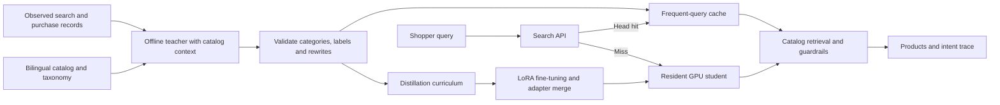

# Pulp Fictional

A grocery search prototype served from a private GPU host. [Set up or connect to the private storefront](docs/serving.md).

Search 144 real grocery listings in English or Chinese. Type into the search box to update the results. The **Intent trace** shows which model interpreted the query, the catalog categories it matched, and the purchase evidence available for that phrase.

## Demo

This narrated walkthrough (1 min 54 sec) follows two searches. “Mooncakes” uses a cached interpretation. Typing “dark chocolate gift box for a friend” runs the model on the H100 and finds a matching gift box. The intent trace shows how each result was found.

https://github.com/user-attachments/assets/3c9496ad-80c4-4db6-a9ae-0576a6d9d6a5

## Try it

1. Open the storefront after starting the service locally or connecting over SSH. It starts with **Mooncakes**. Open **Purchase evidence** in the intent trace to see the original Chinese query and the recorded purchase behind the category match.
2. Type **a sugar-free mooncake**. The server sends this new phrase to the resident language model, validates its proposed rewrites and ranks catalog listings. Each result includes its original source item ID.
3. Refresh the page. The storefront restores the query from the URL and searches again. The model stays loaded on the server.


## Architecture



- **Offline teacher.** Qwen2.5-7B-Instruct uses purchase-derived brand and category counts, embedding-ranked catalog evidence and the bilingual taxonomy. It reranks converted category paths, extracts product, brand and attributes, and answers separate prompts for synonyms, substitutes and broader searches. The pipeline saves the raw generations alongside the validated curriculum. [Teacher pipeline](scripts/real_teacher.py) · [Teacher records](experiments/market/teacher.json)
- **Online routing.** A single search API checks the frequent-query cache. A miss runs Qwen3-0.6B, fine-tuned on the teacher's labels and merged with its LoRA adapter, in bfloat16 on the H100. The model stays loaded across visitors and page reloads. The trace offers a forced live run on cached queries for inspection. [Search service](src/pulp_fictional/service.py) · [Training and held-out evaluation](experiments/market/README.md)
- **Retrieval.** A resident ranker combines bilingual semantic vectors, model concepts and available historical purchase evidence. It checks explicit brands against the catalog's brands and listing titles, checks dietary constraints against source labels, and validates rewrites against the products they retrieve. The trace omits model tags that lack support in the query or matching listings. [Catalog ranker](live/retrieval.js) · [Serving checks](src/pulp_fictional/rank.cjs) · [Embedding builder](scripts/build_embeddings.py)

## Data and scope

KuaiSearch-Lite supplies the original queries, product listings and purchased-item IDs. The catalog covers six grocery departments. Its 185 original queries link to 209 distinct query–product pairs and 225 session–product purchase occurrences. Counts belong to the historical Chinese query. A new English phrase has no purchase history of its own. The storefront displays original titles alongside editorial English translations. This research catalog has no current retail prices, stock feed or checkout. [Data selection and license](live/data/README.md) · [KuaiSearch research release](https://benchen4395.github.io/KuaiSearch/)

## Run the tests

```sh
uv run --frozen python -m unittest discover -s tests
node --test tests/*.cjs
```
